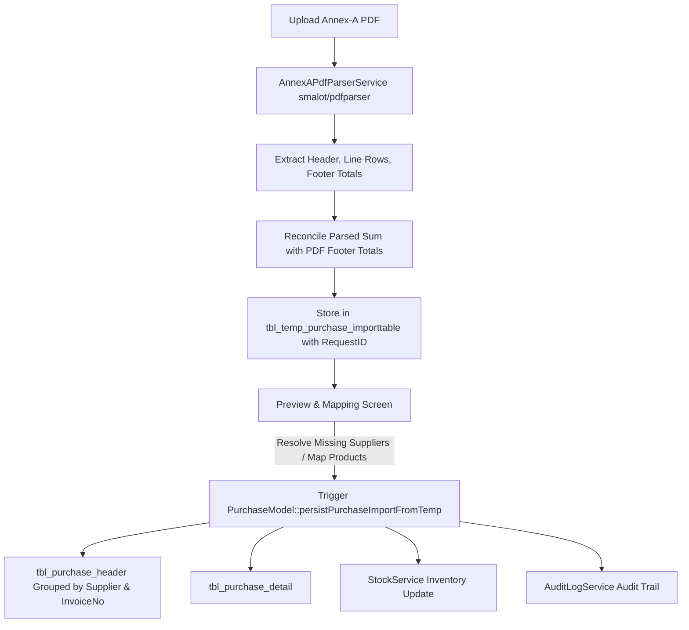

# FBR Annex-A PDF Purchase Import Architecture & Implementation Plan

## 1. Executive Summary
This document defines the architectural plan and technical roadmap to replace Excel-based purchase imports with direct **FBR Annex-A (Domestic Purchase Invoices) PDF** import.

The system will:
1. Parse multi-page FBR Annex-A PDF files.
2. Extract invoice headers, line items, and summary totals.
3. Stage the parsed data in `tbl_temp_purchase_importtable` with a unique `RequestID`.
4. Provide a review/preview interface for supplier/product resolution and reconciliation.
5. Persist validated records to `tbl_purchase_header` and `tbl_purchase_detail` within the active tenant database, updating inventory and audit logs.

---

## 2. FBR Annex-A PDF Document Structure

### Document Header Metadata
* **Buyer Registration No (NTN/CNIC)**: `5440003634489`
* **Buyer Name**: `KHAN MUHAMMAD`
* **Tax Period**: `01-Jun-2026 / 30-Jun-2026`
* **Return Status**: `Submitted`

### Column Grid Mapping
| Annex-A Column Name | Target Temp Field (`tbl_temp_purchase_importtable`) | Description |
| :--- | :--- | :--- |
| `Sr No.` | `RowNo` | Sequence number (1, 2, 3...) |
| `Particulars of Sellers -> Registration No.` | `SellerRegistrationNo` | Supplier NTN / CNIC / STRN |
| `Particulars of Sellers -> Name` | `SellerName` | Supplier Business / Legal Name |
| `Particulars of Sellers -> Type` | `TaxpayerType` | Registered / Unregistered |
| `Sale Origination Province` | `SaleOriginationProvince` | Province of supplier (e.g. BALOCHISTAN) |
| `Document Type` | `InvoiceType` | Purchase Invoice, Debit Note, etc. |
| `Invoice Details -> No.` | `InvoiceNo` | FBR Document Ref No (e.g. 0656656DI4PGLOT...) |
| `Invoice Details -> Date` | `InvoiceDate` | Date of invoice (e.g. 30-Jun-2026) |
| `Invoice Details -> HS Code` | `HsCode` | 8-digit HS Code (e.g. 2523.1000) |
| `Invoice Details -> Purchase Type` | `SaleType` | Purchase classification (3rd Schedule, Standard, etc.) |
| `Invoice Details -> Rate` | `Rate` | Sales Tax % (e.g. 18%) |
| `Invoice Details -> Uom` | `Uom` | Unit of measure (e.g. KG, PCS) |
| `Invoice Details -> Quantity/Unit` | `Quantity` | Quantity purchased |
| `Invoice Details -> Value of Purchases` | `ValueSalesExcludingST` | Base purchase amount (excl. ST) |
| `Invoice Details -> Fixed / notified` | `FixedNotifiedValueOrRetailPrice` | Fixed/Notified/Retail valuation |
| `Invoice Details -> Sales Tax/ FED in ST.` | `SalesTaxFedInStMode` | Sales Tax / FED amount |

### Footer Totals (Reconciliation Target)
* **Total Quantity** (e.g., `1,042,000.00`)
* **Total Value of Purchases** (e.g., `19,546,518.00`)
* **Total Sales Tax / FED in ST** (e.g., `4,707,502.00`)

---

## 3. End-to-End Processing Architecture



---

## 4. Technical Specifications

### 4.1. PDF Parser Engine
* **Library**: `smalot/pdfparser` (Pure PHP via Composer, zero OS binary dependencies).
* **Multi-line Text Wrapping**: Handled with a line-state machine using `Sr No.` and invoice date anchors to rejoin wrapped text (e.g. `BALOCHIST` + `AN`).
* **Checksum Reconciliation**: The service ensures that:
  $$\sum \text{Row Quantity} = \text{Footer Total Quantity}$$
  $$\sum \text{Row Value} = \text{Footer Total Value}$$
  $$\sum \text{Row Tax} = \text{Footer Total Tax}$$

### 4.2. Staging Table (`tbl_temp_purchase_importtable`)
* Each import batch is tagged with a UUID `RequestID`, user ID, and timestamps.
* Pre-validation queries flag:
  * Invoices with unregistered suppliers.
  * Invoices already imported previously (`InvoiceNo` duplicate check).

### 4.3. Supplier & Product Resolution
* **Supplier Matching**: Matches `SellerRegistrationNo` against `tbl_customer.NTN` or `CNIC`.
  * If found: Links `SupplierID`.
  * If missing: Allows 1-click supplier creation from the extracted FBR name & registration number.
* **Product Matching**: Matches `HsCode` against `tbl_product.HsCode` or defaults to standard category items.

### 4.4. Production Persistence (`PurchaseModel`)
* Records are grouped by `(SupplierID, InvoiceNo, InvoiceDate)` to create header rows in `tbl_purchase_header`.
* Detail rows are inserted into `tbl_purchase_detail`.
* `StockService::applyPurchaseLines()` updates on-hand quantities.
* `AuditLogService::log()` logs the batch creation.

---

## 5. Implementation Roadmap

1. **Composer Package Installation**:
   ```bash
   composer require smalot/pdfparser
   ```
2. **Service Layer**:
   * Create `app/Services/AnnexAPdfParserService.php`.
3. **Controller & Routes**:
   * Update `PurchaseController@importPurchases` and import modal to accept PDF files.
   * Add staging review endpoints.
4. **Staging & Persistence Layer**:
   * Implement `PurchaseModel::runTempPurchaseImportValidation()` and `PurchaseModel::persistPurchaseImportFromTemp()`.
5. **UI & Verification**:
   * Staging review dialog with reconciliation badges (Total vs Parsed).
